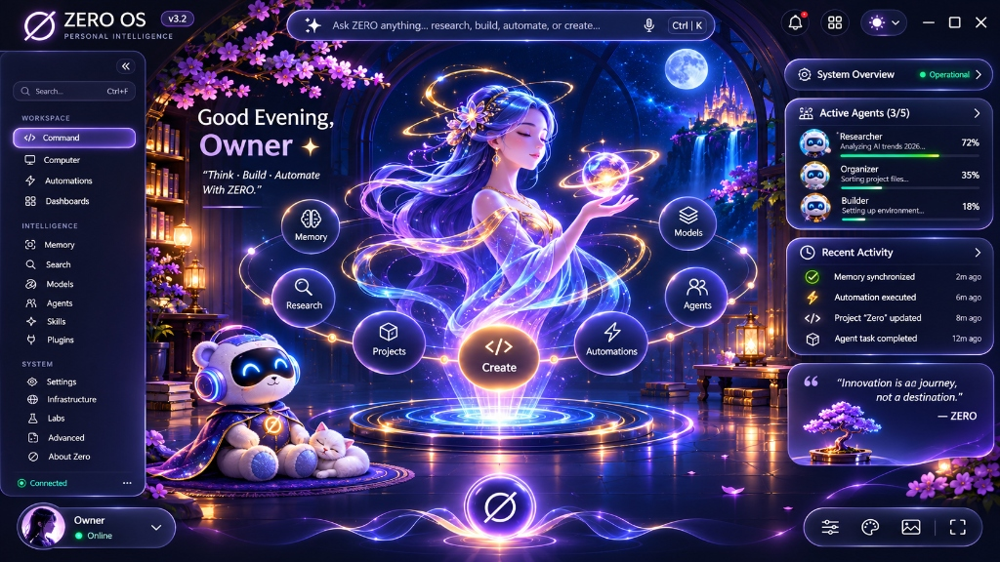

# ZERO OS — Living Observatory

> **ZERO AI**: Personal Intelligence Operating System  
> Complete Visual Interface Design & Next-Generation Frontend Implementation

An extraordinary, distinctive desktop operating experience combining cinematic science fantasy aesthetics, a 3D living holographic companion, an adorable plush robot buddy, mathematical orbital navigation, and high-performance desktop workspaces.



---

## ✨ Key Features

- **Living Holographic AI Companion**:
  - Ethereal genie digital presence with breathing aura, fluid energy trails, and dynamic cursor-following 3D perspective.
  - Luminous star orb held in hand with floating planetary rings and light pulses.
- **Plush Robot Mascot ("ZERO Buddy")**:
  - Soft plush companion seated on a floor cushion beside a sleeping kitten.
  - Interactive LED eye emotions (Happy, Thinking, Curious, Sleepy, Proud).
  - Web Audio synthesized joyful chirps and speech bubble reactions on click.
- **Holographic Orbital Capability Navigation**:
  - True spatial elliptical coordinate paths around the AI character.
  - Thin-ring circular glowing nodes: Memory, Agents, Models, Automations, Computer, Skills, Plugins.
  - Instant contextual flyout drawer without leaving the sanctuary scene.
- **Compact Expandable Spatial Rail**:
  - Slim 60px curved frosted-glass navigation rail with glowing micro-indicators.
  - Smooth expansion to 240px with categorized sections: Workspace, Intelligence, System.
- **Floating Conversational Command Console**:
  - Floating lower-center console with auto-growing textarea, speech mic animation, model routing selector, and quick intent pills.
- **Collapsible Live Operations Panel**:
  - 3 dedicated telemetry tabs: **Tasks** (active swarm delegations), **Computer** (live desktop preview & OCR status), and **System** (CPU, RAM, storage, network dials).
  - Collapses into a sleek floating glowing orb with live pulse indicator.
- **Appearance & Companions Studio**:
  - 5 Celestial Color Themes: Astral Violet, Ethereal Cyan, Solar Amber, Emerald Aurora, Cosmic Amethyst.
  - 5 Sanctuary Environment Presets: Night Sanctuary, Gothic Cathedral, Magical Library, Robot Tactical Desk, Cyber Hologram.
  - Real-time sliders for Hologram Aura Glow and Stardust/Petal Density.
- **Dedicated Workspaces**:
  - Focused Command Chat with tool execution cards.
  - Computer Control & Vision Intelligence with permission hold guards.
  - Autonomous Agent Workforce directory and delegation hierarchy.
  - 8-Layer Cognitive Memory browser & vector graph.
  - Deep Web Research workspace with multi-source crawler and scratchpad.
  - Model Fabric with 14 models across 5 providers.
  - Skills Library & Plugin Bridges.
  - Scheduled Automations Studio & Projects Hub.
- **Web Audio Sound Synthesizer**:
  - Low-latency synthesized sci-fi sound effects for hover ticks, orbital harmonic chords, command warp pulses, and mascot notifications.

---

## 🚀 Getting Started

### Prerequisites
- Node.js (v18+ or v24+)
- npm or pnpm

### Installation

```bash
# Clone the repository
git clone https://github.com/aipubg/zero-ui.git
cd zero-ui

# Install dependencies
npm install

# Start the development server
npm run dev
```

Open [http://localhost:5173](http://localhost:5173) in your browser.

### Production Build

```bash
npm run build
npm run preview
```

---

## ⌨️ Global Shortcuts

- <kbd>Ctrl</kbd> + <kbd>K</kbd> / <kbd>Cmd</kbd> + <kbd>K</kbd> — Open Global Command & Capability Palette
- <kbd>Esc</kbd> — Close modals, contextual panels, and palette
- <kbd>Enter</kbd> — Dispatch command from command console
- <kbd>Shift</kbd> + <kbd>Enter</kbd> — Multiline message input

---

## 🎨 Technology Stack

- **Framework**: React 19 + Vite 8
- **Styling**: Tailwind CSS v4 + Custom Glassmorphism Design Tokens
- **Icons**: Lucide React
- **Graphics**: HTML5 Canvas 2D Stardust & Petal Physics + WebGL Shaders
- **Audio**: Web Audio API Procedural Synthesizer
